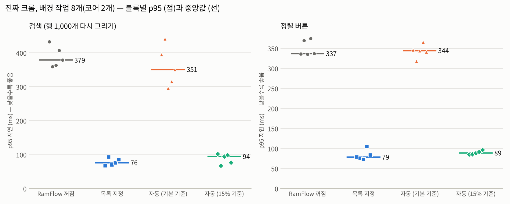

# 진짜 크롬 시험 (2026-11-18)

윈도우용 RamFlow가 진짜 앱으로 잰 것과 같은 방식으로, 리눅스 버전도 **진짜 크롬**으로 쟀습니다.
흉내 낸 프로그램이 아니라 실제 크롬이 실제 입력(검색 입력, 버튼 클릭)을 받고, 화면이 그려질 때까지 걸린 시간을 쟀습니다.

## 어떻게 쟀나

- 크롬 153(실제 브라우저)을 개발자 도구 통로로 조종합니다. 입력은 사람이 넣는 것과 같은 방식입니다.
- 시험 화면: 기록 20,000개짜리 표. **검색**은 행 1,000개를 새로 그리고, **정렬 버튼**은 다시 정렬해 그립니다.
  결과가 맞는지(행 수, 첫 줄, 끝 줄)를 매번 따로 계산해 대조했습니다.
- 재는 것: 입력을 보낸 순간부터 두 번째 화면 갱신까지(= 눈에 보이는 반응 시간).
- 방해꾼: 배경 작업 8개(각각 스레드 2개, 해시 계산), 각자 다른 세션에서 실행. 코어는 2개뿐이라 항상 자리가 모자랍니다.
- 조건 4가지: ① 꺼짐 ② 목록 지정(배경 작업 이름을 알려 줌) ③ 자동(기본 기준: 코어의 35%를 5초 이상) ④ 자동(15% 기준)
- 5번 반복하고, 매번 조건 순서를 섞었습니다(고정 시드). 조건마다 12초 적응 → 5번 연습 → 기능당 30번 측정.
- 조건마다 끝난 뒤 우선순위가 원래대로 돌아왔는지, 저널이 지워졌는지 확인했습니다.

## 결과 (p95 지연, 블록별 값의 중앙값)

| | 꺼짐 | 목록 지정 | 자동(기본) | 자동(15%) |
|---|---|---|---|---|
| 검색 | 379 ms | **76 ms** (−80%, 5/5) | 351 ms (−7%, 4/5) | **94 ms** (−75%, 5/5) |
| 정렬 | 337 ms | **79 ms** (−77%, 5/5) | 345 ms (+2%, 2/5) | **89 ms** (−74%, 5/5) |
| 배경 작업 처리량 | 기준 | −8.3% | −1.0% | −6.0% |

- 측정 1,200번 전부 화면 결과가 맞았고, 20개 조건 전부 원래대로 복구됐고, "효과 없음"으로 물러난 적은 없습니다.
- 배경 작업은 멈추지 않고 남는 자리에서 계속 돕니다. 대가는 처리량 6~8% 감소입니다.
- 원자료: [`trials.csv`](evidence/2026-11-18-real-chrome/trials.csv), [`summary.json`](evidence/2026-11-18-real-chrome/summary.json),
  [`raw.json`](evidence/2026-11-18-real-chrome/raw.json)(전 측정값), [`logs/`](evidence/2026-11-18-real-chrome/logs/)(조건별 동작 기록과 1샘플당 추적).
- 다시 돌리기: `sudo python3 bench/chrome-study/study.py` (크롬·node·파이썬만 있으면 됩니다), 차트는 `chart.py`.

## 솔직하게 말할 것

- **기본 자동 모드는 이 시험에서 효과가 없었습니다.** 배경 작업 8개가 코어 2개를 나누면 하나당 약 25%라서, 기본 기준(35%)에 안 걸립니다.
  기준을 15%로 낮추면 목록을 안 줘도 거의 같은 효과가 났습니다. 기본값은 아직 바꾸지 않았습니다(오작동 위험과 맞바꾸는 문제라 더 많은 환경에서 본 뒤 정하겠습니다).
- 시험 중 RamFlow의 판단 결함 두 개를 찾아 고쳤습니다. 둘 다 커밋 `be3e95d`에 들어 있습니다.
  1. 활동이 거의 없는 순간에 대기 비율이 100%로 튀어, 효과가 있는데도 "효과 없음"으로 물러났음 → 활동량에 비례해 반영.
  2. 효과 판단의 기준값이 시작 직후 값이라 실제 고통보다 낮게 잡혔음 → 시작을 일으킨 실측값의 평균으로 변경.
- 환경은 하나입니다: 코어 2개짜리 가상머신, 커널 6.18, 화면 없는 크롬, 인공 배경 작업. 코어가 많은 실제 PC에서는 수치가 다를 수 있습니다.
  배경 작업이 **모두 다른 세션**인 경우만 쟀습니다(같은 세션 경우는 앞선 실험 `2026-11-18-v0.2-effect`에 있습니다).
- 고정 우선순위(수동으로 세션 우선순위 19)로도 같은 정도(289→78 ms)가 나왔습니다. RamFlow의 가치는 "필요할 때만 자동으로 걸고 끝나면 정확히 되돌리며, 효과가 없으면 스스로 물러나는 것"에 있고, 낮출 수 있는 한계 자체는 커널이 정합니다.
